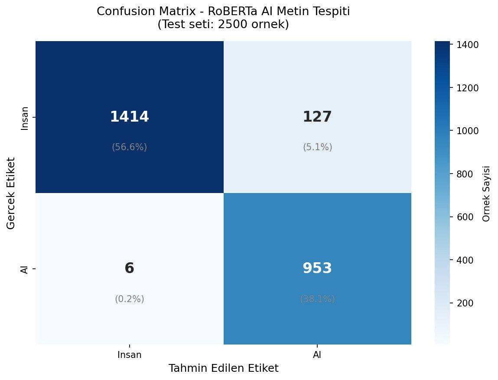
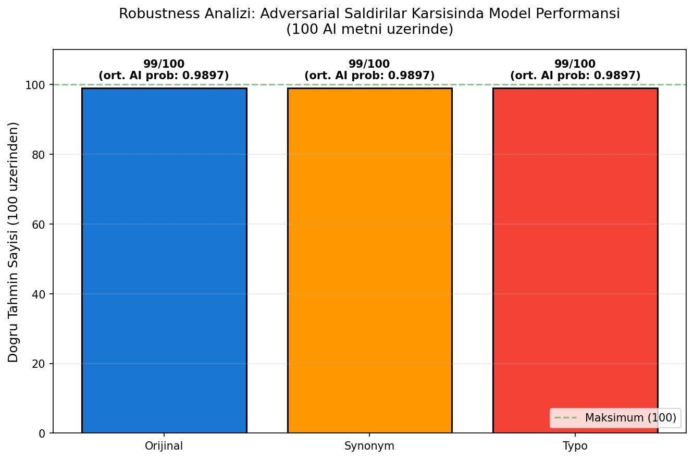
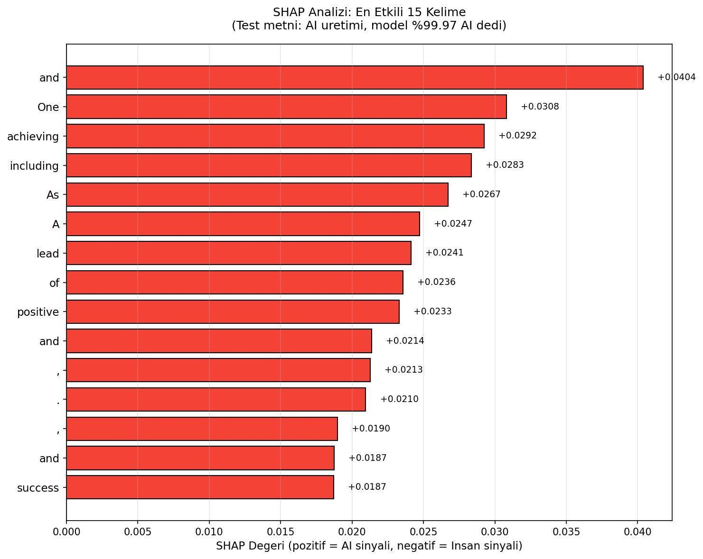
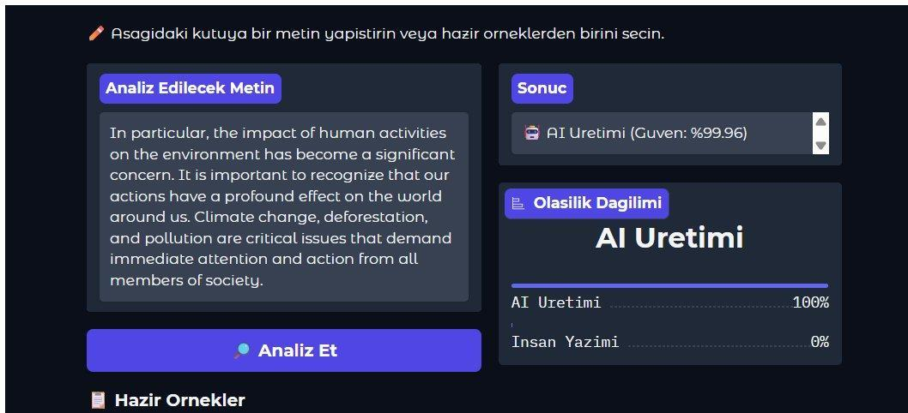
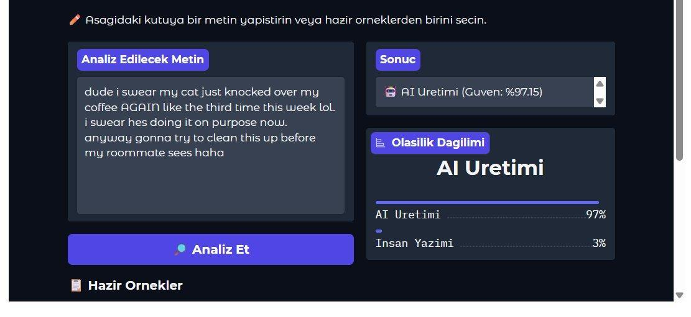

# Transformer Tabanlı Yapay Zekâ Metni Tespiti: Dayanıklılık ve Açıklanabilirlik Analizi

RoBERTa-base ile bir metnin **insan mı yoksa yapay zekâ mı** yazdığını tespit eden bir sınıflandırıcı. Proje yalnızca doğruluğa bakmaz; modelin **adversarial saldırılara dayanıklılığını** ve **SHAP ile karar gerekçesini** de inceler.

Kaggle yarışması: [LLM - Detect AI Generated Text](https://www.kaggle.com/competitions/llm-detect-ai-generated-text)
Kaggle notebook: [notebook3d6a0584d5](https://www.kaggle.com/code/fundanurztrk/notebook3d6a0584d5)

Bu çalışma, Perseptron Ağlar ve Uygulamaları (BM466) dersi dönem projesi olarak hazırlanmıştır.

## Ana bulgu: dağılım yanlılığı (distributional bias)

~%95 doğruluğa rağmen model "yapay zekâ mı, insan mı" ayrımını değil, büyük ölçüde **"resmî/akademik essay mi, değil mi"** ayrımını öğreniyor. SHAP analizi, kararı en çok `important`, `significant`, `particular`, `impact` gibi biçimsel bağlaç ve niteleyicilerin sürüklediğini gösteriyor. Sonuç olarak resmî yazılmış insan metinleri, hatta çok gündelik bir insan metni bile yüksek olasılıkla yapay zekâ sanılıyor.

## Yöntem

| | |
|---|---|
| Model | RoBERTa-base (~124M parametre), HuggingFace Transformers |
| Veri | Kaggle LLM-Detect resmî verisi + DAIGT V2, birleşik 46.246 örnek |
| Alt küme | 10.000 eğitim / 2.500 test (tabakalı, seed=42) |
| Eğitim | 2 epoch, batch 32, lr 2e-5, max uzunluk 128, weight decay 0,01, fp16 |
| Dayanıklılık | nlpaug ile eş anlamlı (SynonymAug) ve yazım hatası (RandomCharAug) saldırıları, 100 yapay zekâ metni |
| Açıklanabilirlik | SHAP |
| Arayüz | Gradio |

## Sonuçlar

| Metrik | Değer |
|---|---|
| Doğruluk | %94,7 |
| Kesinlik (AI) | 0,88 |
| Duyarlılık (AI) | 0,99 |
| F1 | 0,93 |

Hata yapısı asimetrik: 959 yapay zekâ metninden yalnızca 6'sı kaçırıldı, buna karşılık 1.541 insan metninin 127'si yanlışlıkla yapay zekâ olarak işaretlendi.

### Dayanıklılık

Orijinal, eş anlamlı ve yazım hatası senaryolarının üçünde de 99/100 doğru tahmin. Kelime ve karakter düzeyindeki saldırılar modeli bozamıyor. Bunun nedeni büyük olasılıkla modelin anlamdan çok biçimsel kalıplara dayanması ve BPE alt-kelime tokenizasyonu. Cümle düzeyinde paraphrase saldırısı test edilmedi.

### Açıklanabilirlik (SHAP)

### Demo arayüzü

Resmî üslupta yazılmış insan metni yapay zekâ olarak işaretleniyor:

Çok gündelik bir insan metni de yapay zekâ olarak işaretleniyor:

Daha fazla görsel `images/` klasöründe.

## Nasıl çalıştırılır

Proje Kaggle üzerinde geliştirildi (GPU T4 x2).

1. Kaggle'da yeni notebook açın, `notebooks/roberta_ai_text_detection.ipynb` dosyasını içe aktarın.
2. Şu veri setlerini notebook'a ekleyin:
   - [LLM - Detect AI Generated Text](https://www.kaggle.com/competitions/llm-detect-ai-generated-text) (yarışma verisi)
   - [DAIGT V2 Train Dataset](https://www.kaggle.com/datasets/thedrcat/daigt-v2-train-dataset)
3. Accelerator olarak GPU seçin ve hücreleri sırayla çalıştırın. Eğitim yaklaşık 5 dakika sürer.

Notlar: Veri yolları Kaggle ortamına göre yazılmıştır (`/kaggle/input/...`). Başka bir ortamda çalıştıracaksanız yolları değiştirin. Veri setleri ve eğitilmiş model bu repoda yer almaz.

## Sınırlamalar

- İnsan metinleri ağırlıklı olarak öğrenci kompozisyonlarından geliyor, günlük, edebî ve teknik üslup yetersiz temsil ediliyor.
- Yalnızca İngilizce metinlerle eğitildi ve test edildi.
- Güven skorları kalibre edilmedi, yüksek yanlış pozitif oranı nedeniyle model tek başına kanıt olarak kullanılmamalı.

## Kaynaklar

- Sadasivan et al., *Can AI-generated text be reliably detected?*, arXiv:2303.11156, 2023
- Hans et al., *Spotting LLMs with Binoculars*, ICML 2024
- Liu et al., *RoBERTa: A robustly optimized BERT pretraining approach*, arXiv:1907.11692, 2019
- Lundberg & Lee, *A unified approach to interpreting model predictions*, NeurIPS 2017

## Lisans

MIT, ayrıntı için `LICENSE` dosyasına bakın.
